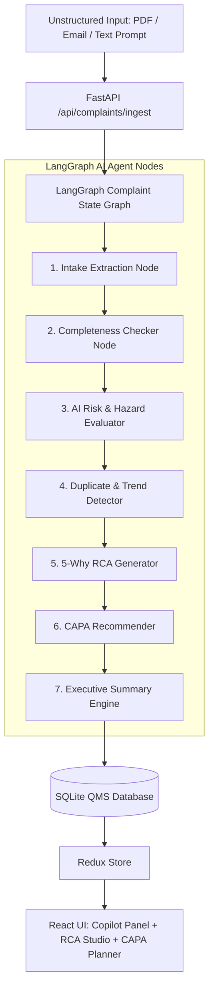

# AIVOA – AI-Powered Customer Complaint Management System (Pharma QMS)

An enterprise-grade, autonomous **AI-Powered Customer Complaint Management System** designed for the pharmaceutical manufacturing industry (Active Pharmaceutical Ingredients - API & Finished Dosage Forms - FDF).

Built for the **AIVOA Round 1 AI Product Engineer (Interns)** challenge.

---

## 🏛️ Domain Context & Regulatory Compliance
In pharmaceutical manufacturing:
- **Finished Dosage Forms (FDF)**: Oral solid tablets, capsules, parenteral injectables. Complaints focus on product integrity (capping, cracking, discoloration), particulate contamination, sub-potency, or blister packaging defects.
- **Active Pharmaceutical Ingredients (API)**: Raw chemical/biological powders. Complaints focus on Out-of-Specification (OOS) impurity profiles, assay degradation, heavy metal traces, or container closure failures.
- **21 CFR Part 211.198 & EU GMP Annex 11**: Mandates strict intake logging, data completeness, root cause investigation (RCA), CAPA assignment, and immediate 15-day Field Alert reporting for critical health hazards.

---

## 🚀 Mandatory Technology Stack

| Layer | Technology |
| :--- | :--- |
| **Frontend** | React 18 (Vite) with **Redux Toolkit** for global state management |
| **Styling & Typography** | Modern QMS Glassmorphic UI using Vanilla CSS & **Google Inter font** |
| **Backend** | Python 3.10+ with **FastAPI** |
| **AI Agent Framework** | **LangGraph** (`StateGraph`) defining a 7-stage directed acyclic workflow |
| **LLM Engine** | **Groq API** utilizing `gemma2-9b-it` (Default) & `llama-3.3-70b-versatile` (Context Re-assessment) |
| **Database** | Async SQLAlchemy + **SQLite** (`qms_complaints.db`) |

---

## 🧠 LangGraph Autonomous AI Workflow



---

## 🌟 Implemented Features & Bonus Tools

1. **AI Intake & PDF/Email Parser**: Drag-and-drop file uploader or raw text prompt parser that extracts customer, batch, and defect metadata.
2. **Auto-Filled Log Customer Complaint Form**: Interactive form populated by AI extraction.
3. **AI Copilot Risk Assessment & Triage**: Evaluates Health Hazard Class (Class I, II, III), Risk Priority Number (RPN 1-100), and triggers mandatory **FDA 15-Day Alert** warnings.
4. **Complaint Completeness Checker**: Evaluates 21 CFR Part 211.198 data completeness percentage and generates one-click AI follow-up emails for missing parameters.
5. **5-Why Root Cause Analysis (RCA) Studio**: Visual 5-Why causal chain and Ishikawa Fishbone domain classification.
6. **CAPA Recommendation Planner**: Generates actionable Corrective & Preventive Action items with department assignments and status toggles.
7. **21 CFR Executive Summary Report**: Markdown export and printable executive report.
8. **Groq Model Switcher**: Live toggle between `gemma2-9b-it` and `llama-3.3-70b-versatile`.

---

## 💻 Quick Start Guide

### 1. Run Backend (FastAPI)
```bash
cd backend
python -m venv venv
# On Windows:
venv\Scripts\activate
# On Linux/macOS:
source venv/bin/activate

pip install -r requirements.txt

# Optional: Set your Groq API Key (The app has a built-in domain fallback engine if key is omitted)
set GROQ_API_KEY=your_groq_api_key_here

uvicorn main:app --reload --port 8000
```
- API Docs available at: `http://localhost:8000/docs`

### 2. Run Frontend (React + Redux)
```bash
cd frontend
npm install
npm run dev
```
- Open browser at: `http://localhost:3000`

---

## 🧪 Testing Sample Files
You can test the system using sample complaint files located in `/sample_documents/`:
- `complaint_fdf_capping.txt` (Paracetamol 500mg Tablet Capping)
- `complaint_api_oos_impurity.txt` (Metformin API OOS Impurity Peak)
